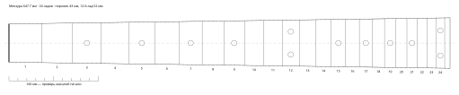
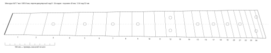

# claude-guitar

Плагин для [Claude Code](https://claude.com/claude-code): калькулятор гитарного мастера.
Claude не считает лады и натяжение «из головы», а вызывает скрипт с формулами и таблицей D'Addario.

*English summary [below](#english).*



## Что умеет

| | Команда | Пример |
|---|---|---|
| Положение ладов | `/guitar:frets` | `/guitar:frets 25.5` |
| Мультимензура (веерные лады) | `/guitar:frets` | `/guitar:frets 25.5 --bass 27 --perp 8` |
| Ширина накладки и compound-радиус по ладам | `/guitar:frets` | `/guitar:frets 25.5 --nut-width 42 --width-12 52 --radius 9.5-14` |
| Натяжение струн | `/guitar:tension` | `/guitar:tension 25.5 "E4 B3 G3 D3 A2 E2" "10 13 17 26w 36w 46w"` |
| Подбор калибров под строй | `/guitar:gauges` | `/guitar:gauges 24.75 "D4 A3 F3 C3 G2 C2" --match "10 13 17 26w 36w 46w"` |
| Угол грифа к корпусу | `/guitar:neck` | `/guitar:neck 24.75 --saddle 19 --board-height 6 --joint-fret 16` |
| SVG-шаблон накладки 1:1 | `/guitar:template` | `/guitar:template 25.5 --bass 27 --perp 8 --a4` |
| Аккорд → таблатура | `/guitar:chord` | `/guitar:chord Abm7+9` |
| Журнал сборки | `/guitar:build` | `/guitar:build new "Tele #2"` |

Команды не обязательны: скилл `guitar` срабатывает и на обычный вопрос —
«какое натяжение у 10–46 в Drop C на 24.75?» или «подбери струны под B-standard на баритоне 27″».

## Установка

```
/plugin marketplace add igorbannicov/claude-guitar
/plugin install guitar@claude-guitar
```

Нужен Python 3 (только стандартная библиотека). Работает на Windows, macOS, Linux, Raspberry Pi.

## Примеры

**Натяжение** — 10–46, E-standard, 25.5″ (совпадает с таблицей D'Addario):

```
 #  нота       Гц    калибр      lb      кг
 1    E4   329.63  0.0100p   16.2    7.35
 2    B3   246.94  0.0130p   15.4    6.97
 3    G3   196.00  0.0170p   16.6    7.51
 4    D3   146.83  0.0260w   18.4    8.34
 5    A2   110.00  0.0360w   19.5    8.85
 6    E2    82.41  0.0460w   17.5    7.92
Всего: 103.5 lb = 46.9 кг
```

**Подбор калибров** — Drop C на 24.75″ с ощущением как у 10–46 в стандарте на той же мензуре:

```
$ guitar.py gauges 24.75 "D4 A3 F3 C3 G2 C2" --match "10 13 17 26w 36w 46w"
...
Комплект: 11 15 19 30w 42w 56w
```

**Мультимензура** 25.5″/27″, перпендикулярный 8-й лад:



**Аккорд → таблатура** — лучшая аппликатура на каждой позиции грифа:

```
$ guitar.py chord Abm7+9
Abm7+9: Ab(1)  Cb(b3)  Eb(5?)  Gb(b7)  Bb(9)
       откр.          4            2            1
 e|-----2------|-----6------|-----2------|-----2------|
 b|-----0------|-----4------|-----4------|-----x------|
 g|-----1------|-----4------|-----3------|-----4------|
 d|-----1------|-----4------|-----x------|-----1------|
 a|-----1------|-----6------|-----2------|-----1------|
 E|-----4------|-----4------|-----4------|-----4------|
    4-1-1-1-0-2  4-6-4-4-4-6  4-2-x-3-4-2  4-1-1-4-x-2
```

Понимает `m`, `maj7`/`Δ`, `7`, `9`, `11`, `13`, `6`, `6/9`, `dim`/`°`, `dim7`, `m7b5`/`ø`, `aug`/`+`, `sus2`/`sus4`, `5`,
добавленные ступени (`add9`, `+9`), альтерации (`b5 #5 b9 #9 #11 b13`), `no5` и бас через слэш (`G/B`).
Любой строй и число струн: `--tuning "D4 A3 F3 C3 G2 C2"`, 7-струнка — `--tuning "E4 B3 G3 D3 A2 E2 B1"`.
Ступени со `?` можно опускать (квинта в септаккордах, нона в 11/13). Ограничения перебора: окно 4 лада,
не больше 4 пальцев (барре — один), открытые струны — только у порожка, нижняя нота — тоника или бас.

## Шаблон для печати

`guitar.py svg 25.5 -o board.svg` — один SVG в натуральную величину (для плоттера, лазера, ЧПУ;
в Inkscape экспортируется в DXF). С `--a4` — листы A4 альбомом с перекрытием 10 мм и красными линиями склейки.

- Печатать в масштабе **100%**, без «подогнать по размеру».
- На первом листе линейка 100 мм — проверь штангенциркулем до того, как пилить.
- Размечать лучше от порожка, а не от предыдущего лада: ошибка не накапливается.

Параметры: `--frets`, `--nut-width` (43), `--width-12` (52), `--edge` — от крайней струны до края у порожка (3.5),
`--bridge-spread` — разнос крайних струн на бридже (52), `--tail` — накладка за последним ладом (6). Всё в мм.

## Журнал сборки

`/guitar:build new "Tele #2"` создаёт `~/guitar-builds/Tele #2.md` со спекой (мензура, накладка, строй, калибры
с натяжением, дерево, железо), `/guitar:build "Tele #2" вклеил лады` — добавляет запись с датой.
Папку можно поменять переменной окружения `GUITAR_BUILDS`.

## Формулы и данные

- Лады, 12-TET: `x(n) = L · (1 − 2^(−n/12))`.
- Мультимензура: каждая сторона считается по своей мензуре, нули сдвинуты так, чтобы перпендикулярный лад совпал;
  лад — прямая через точки на крайних струнах, продлённая до краёв накладки.
- Натяжение (формула D'Addario): `T [lb] = UW · (2 · L · F)² / 386.4`, `UW` — вес погонного дюйма, lb/in.
- `UW` — из [D'Addario String Tension Specifications](https://web.archive.org/web/20260222151657/https://www.daddario.com/globalassets/pdfs/accessories/tension_chart_13934.pdf):
  Plain Steel (.007–.026) и XL Nickelplated Steel Round Wound (.017–.080).
  Калибра нет в таблице — вес интерполируется по соседним (log-log), строка помечается `≈`.
- Ширина накладки — линейно по ширине у порожка и у 12-го лада; compound-радиус — линейно от порожка до последнего лада.
- Угол грифа: `tan θ = (H − h − f − 2a) / d`, где `H` — верх седла над декой, `h` — верх накладки над декой у стыка,
  `f` — высота лада, `a` — зазор над 12-м ладом, `d` — от стыка до седла. Угол > 0 — гриф откинут назад.

## Ограничения

- Только 12-TET и A4 = 440 Гц.
- Натяжение — для никелированных струн с круглой навивкой; у нержавейки, flatwound, бронзы удельный вес другой.
- Угол грифа — упрощённая модель (струна у порожка на высоте лада, косинусы малых углов не учитываются).
- Компенсации седла нет намеренно: её всё равно выставляют по тюнеру на собранном инструменте.

Скрипт можно запускать и без Claude: `python skills/guitar/scripts/guitar.py --help`.

---

## English

A [Claude Code](https://claude.com/claude-code) plugin for luthiers. Instead of guessing, Claude runs a
stdlib-only Python script:

- **frets** — 12-TET fret positions, multiscale (fanned) frets, fretboard width and compound radius per fret;
- **tension** — string tension from D'Addario unit weights (plain steel + XL nickel wound);
- **gauges** — pick a set for a tuning: target tension or "feel like 10–46 in standard";
- **neck** — neck angle and neck projection;
- **svg** — 1:1 fretboard template, single sheet or tiled A4 pages with glue lines and a 100 mm check ruler;
- **chord** — chord symbol to tab (`Abm7+9`, `F#m7b5`, `G/B`…), best voicing per neck position, any tuning;
- **build log** — Markdown spec + dated notes per build.

Install: `/plugin marketplace add igorbannicov/claude-guitar`, then `/plugin install guitar@claude-guitar`.
Output and prompts are in Russian; the CLI flags are self-explanatory (`--help`).

## Лицензия

MIT
